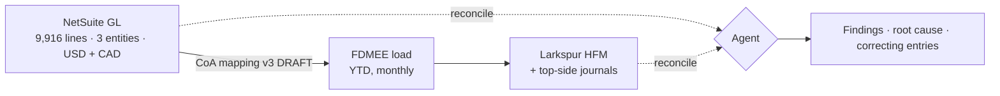

# Acquisition Reconciliation Agent

**After an acquisition, two finance systems report the same company, and they don't tie.**
This project is a benchmark and an AI agent that finds every break, explains its root cause, and proposes the correcting entry.

  

> [!IMPORTANT]
> **All data is synthetic.** Sparrow Pizza Co., Larkspur Restaurant Group, every vendor, store, person and dollar amount are fictional and generated by [`src/generate_data.py`](src/generate_data.py). No employer or client data is used.

---

## The scenario

Larkspur Restaurant Group (acquirer, **Oracle HFM**) closed on Sparrow Pizza Co. (target, **NetSuite**). Sparrow's Q3 FY26 trial balance was mapped and loaded into Larkspur's consolidation. Before the numbers go to the deal team, someone has to prove the two systems agree.



## What's seeded

**33 issues · 10 types · $21.7M of misstatement.** Half are visible in a standard tie-out. The other half sit inside the mapping or flow into *both* systems, so the numbers tie and the error survives.

| Issue type | # | Impact | Visible in a tie-out? | What it looks like |
|---|--:|--:|:-:|---|
| Mapping error | 3 | $8.06M | ✗ | Delivery fees landing in *Franchise Royalties* at a company-owned entity |
| Sign flip | 2 | $4.32M | ✓ | Discounts loaded positive for one month |
| Unmapped account | 2 | $2.52M | ✓ | New M&A cost account opened in Aug, silently rejected by the load |
| Cutoff / timing | 6 | $2.05M | ✓ | Entry back-dated to July *after* the July extract, surfacing in August |
| Intercompany mismatch | 3 | $1.60M | ✗ | Canada books royalty at the old 4.5% rate; franchising entity bills 5% |
| Capex expensed | 3 | $0.93M | ✗ | 14 new conveyor ovens coded to Repairs & Maintenance |
| Missing accrual reversal | 3 | $0.92M | ✗ | July utility accrual never reversed, so August is double-counted |
| Duplicate HFM journal | 4 | $0.81M | ✓ | PPA depreciation journal posted twice by different preparers |
| Duplicate GL entry | 5 | $0.32M | ✗ | Same vendor invoice keyed twice, Ref No. `WB-2026-…` vs `WB2026-…` |
| FX translation | 2 | $0.16M | ✓ | CAD P&L translated at closing rate instead of average |

Every issue in [`answer_key/seeded_issues.json`](answer_key/seeded_issues.json) carries its root cause, evidence (NetSuite Internal IDs, HFM journal IDs), affected cells, and the correcting entry.

## Scorecard

| | Detected | Root cause correct | $ surfaced | False positives |
|---|:-:|:-:|:-:|:-:|
| Rules-based tie-out ([baseline](src/baseline_recon.py)) | 16 / 33 | 2 / 33 | 45% | 4 |
| **Agent** | *in progress* | | | |

The baseline is what most teams run by hand: roll the GL through the mapping, translate, compare. It finds breaks but can't say *why*, misses every mapping error (HFM is consistent with the bad map), and flags four legitimate purchase-accounting journals as errors.

## Quickstart

```bash
pip install -r requirements.txt
python src/generate_data.py                       # rebuild the dataset (deterministic, seed 2026)
python src/baseline_recon.py                      # run the tie-out
python src/evaluate.py outputs/baseline_findings.csv --label "Baseline"
```

Score any approach by writing findings to CSV in the [findings schema](src/evaluate.py) and running `evaluate.py`.

## Data room

| File | System | Contents |
|---|---|---|
| `sparrow_netsuite/SPZ_GL_Detail_FY26Q3_IncomeStatement.csv` | NetSuite | Saved-search GL detail: bills, payroll, POS batches, accruals, IC |
| `sparrow_netsuite/SPZ_Chart_of_Accounts.csv` | NetSuite | 41 P&L accounts with normal balance and open date |
| `larkspur_hfm/LRG_HFM_Extract_SPZ_FY26Q3.xlsx` | HFM | Smart View grid: entity × account × ICP, periodic USD |
| `larkspur_hfm/LRG_HFM_Journal_Register_FY26Q3.csv` | HFM | Top-side journals with preparer, approver, support |
| `larkspur_hfm/LRG_HFM_Load_Log_FY26Q3.csv` | FDMEE | Extract timestamps, mapping version, rejected rows |
| `mapping/SPZ_to_LRG_CoA_Mapping_v3_DRAFT.xlsx` | Excel | Account mapping as loaded, with status, reviewer and change log |
| `reference/LRG_Treasury_FX_Rates_FY26Q3.csv` | Treasury | Official CAD/USD average and closing rates |
| `reference/Entity_Map.csv` | — | NetSuite subsidiary ↔ HFM entity |

## Roadmap

- [x] Synthetic data room with seeded, scored issues
- [x] Rules-based baseline and evaluator
- [ ] Claude agent: mapping review, tie-out, root-cause diagnosis, correcting entries
- [ ] Human-in-the-loop approval UI (Streamlit)

## Repo

```
data/          synthetic source systems (the agent's inputs)
answer_key/    seeded issues (evaluation only; agents must not read this)
src/           generator · baseline · evaluator
outputs/       findings and scorecards
```

---

Built by **Mayur Polani** · FP&A and data analytics; ex-Deloitte AI Integration · [LinkedIn](https://www.linkedin.com/in/mayur-polani/) · mayurpolani@gmail.com
